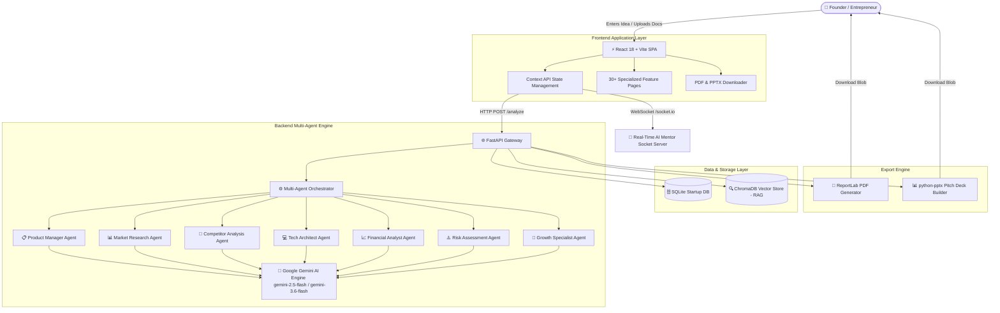

# 🚀 IdeaExecutor: AI Startup Co-Founder & Operating System

[](https://github.com/Swasthiga17/ai-startup-company-helper)
[](https://ai.google.dev/)
[](https://fastapi.tiangolo.com/)
[](https://react.dev/)

**IdeaExecutor** is an autonomous, multi-agent AI co-founder and startup operating system. It transforms raw business ideas into production-ready execution blueprints, financial models, investor pitch decks, market research, and strategic roadmaps using Google Gemini LLM agents.

---

## 🌐 Live Web Application & API

* **Live Web App:** [buildyourowncompanyusingaibss.netlify.app](https://buildyourowncompanyusingaibss.netlify.app)
* **Vercel Mirror:** [frontend-two-drab-49.vercel.app](https://frontend-two-drab-49.vercel.app)
* **Backend API Base:** [ai-startup-company-helpe.onrender.com](https://ai-startup-company-helpe.onrender.com)
* **API Documentation:** [ai-startup-company-helpe.onrender.com/docs](https://ai-startup-company-helpe.onrender.com/docs)

---

## 🏗️ System Architecture



---

## ✨ Key Features & Capability Suite

IdeaExecutor equips founders with an end-to-end suite of 30+ intelligent workspace modules:

### 🧠 Multi-Agent Analysis Pipeline
* **Executive Dashboard & Viability Score:** Comprehensive viability rating (0-100%) with automated risk alerts.
* **Market Analysis & TAM/SAM/SOM:** Automated sizing, CAGR calculation, and market macro-trend forecasting.
* **Competitor Intelligence:** Direct vs. indirect matrix analysis, feature parity gap analysis, and moat positioning.
* **SWOT & Risk Gauges:** Visual risk meters across technical, market, financial, operational, and legal dimensions.
* **Business Model Canvas:** Automatically builds the 9 core building blocks of the business canvas.
* **MVP Engineering Roadmap:** Phase-by-phase timeline scheduling and feature prioritisations (MoSCoW framework).
* **3-Year Revenue Forecast:** Financial modeling, unit economics (CAC, LTV, payback period), and break-even calculations.
* **Investor Pitch Deck Builder:** Generates a 10-slide pitch deck complete with native PDF and PPTX downloads.

### 💬 Interactive AI Mentor & Advisory Suite
* **AI Mentor Chat:** Context-aware real-time Q&A assistant powered by WebSockets.
* **Devil's Advocate Agent:** Stress-tests startup ideas, highlighting fatal flaws, risk vectors, and pivot options.
* **Legal Document Generator:** Custom generator for NDAs, SAFE Notes, Founder Agreements, and Term Sheets.
* **Document Intelligence & RAG:** Upload PDFs and text documents into ChromaDB vector storage for AI-powered Q&A.

### 🛠️ Founder Pilot Modules
* **Investor Mode & YC Simulator:** Pitch roleplay simulator with term sheet and valuation estimators.
* **Brand Identity Suite:** AI-driven company naming, taglines, color palette selection, and brand voice definition.
* **Sales Strategy & Outreach:** Outbound cold email drafting, sales script creation, and funnel planning.
* **Hiring Plan & Team Builder:** Key role prioritization, job description generation, and equity allocation guidelines.
* **Technology Stack Architect:** Recommended tech stack, cloud infrastructure costing, and system design advice.
* **Growth & Virality Advisor:** Viral loop design, referral mechanics, and experiment tracking.

---

## 🛠️ Tech Stack

* **Frontend:** React 18, Vite, Tailwind CSS, Framer Motion, Axios, Socket.IO Client, Lucide Icons.
* **Backend:** Python 3.11, FastAPI, SQLAlchemy, Google GenAI SDK (`google-genai`), Socket.IO, ChromaDB, ReportLab, `python-pptx`.
* **AI Provider:** Google Gemini API (`gemini-2.5-flash`, `gemini-3.6-flash`).
* **Deployment:** Netlify / Vercel (Frontend SPA), Render (Backend FastAPI Server).

---

## 🚀 Getting Started (Local Development)

### Prerequisites
* Python 3.10+
* Node.js 18+
* Google Gemini API Key ([Get one here](https://aistudio.google.com/))

### 1. Clone the Repository
```bash
git clone https://github.com/Swasthiga17/ai-startup-company-helper.git
cd ai-startup-company-helper
```

### 2. Backend Setup
```bash
cd backend
python -m venv .venv

# On Windows:
.venv\Scripts\activate
# On macOS/Linux:
source .venv/bin/activate

pip install -r requirements.txt
```

Create a `.env` file in the `backend/` directory:
```env
GEMINI_API_KEY=your_google_gemini_api_key_here
GEMINI_MODEL=gemini-2.5-flash
SECRET_KEY=your_jwt_secret_key_here
```

Start the backend API server:
```bash
# On Windows:
start_backend.bat
# Or manually:
python -m uvicorn app:socket_app --host 0.0.0.0 --port 8000 --reload
```
The API will run at `http://localhost:8000`.

### 3. Frontend Setup
Open a new terminal:
```bash
cd frontend
npm install
npm run dev
```
The application UI will open at `http://localhost:3000` (or `http://localhost:5173`).

---

## 📡 API Reference Overview

| Method | Endpoint | Description |
| :--- | :--- | :--- |
| `POST` | `/api/v1/auth/register` | Register a new founder account |
| `POST` | `/api/v1/auth/login` | Authenticate user & issue JWT token |
| `POST` | `/api/v1/analyze` | Run multi-agent AI execution pipeline on a startup idea |
| `POST` | `/api/v1/chat` | Send a prompt to the context-aware AI Mentor |
| `POST` | `/api/v1/devils-advocate` | Run Devil's Advocate stress-testing & pivot analysis |
| `POST` | `/api/v1/ai/document/generate` | Generate legal/founder documents dynamically |
| `POST` | `/api/v1/upload-document` | Upload document into ChromaDB RAG vector store |
| `GET` | `/api/v1/download/pdf` | Download formatted PDF analysis report |
| `GET` | `/api/v1/download/pptx` | Download 10-slide PowerPoint pitch deck |
| `GET` | `/health` | API service health check |

---

## 📄 License & Attribution

Distributed under the MIT License. Built with ❤️ for startup founders and entrepreneurs worldwide.