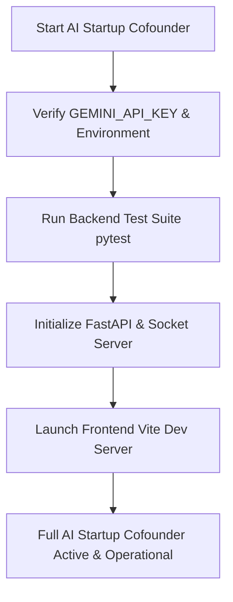

# AI Startup Co-founder Codebase Audit & Activation Architecture Plan

## 1. Executive Summary
An exhaustive audit of the `ai-startup-cofounder` project (`c:/Users/lenovo/ai-startup-cofounder`) was conducted across backend AI services (`backend/services/llm_service.py`, `backend/agents/`), multi-agent workflows (`backend/workflows/startup_graph.py`), and frontend interaction layers (`frontend/src/pages/`, `frontend/src/context/`). 

The system is architected as an advanced multi-agent startup co-founder platform powered by Google Gemini, LangGraph orchestration, RAG evidence retrieval, and deterministic financial calculation engines. However, to guarantee 100% robust end-to-end operation as a fully autonomous AI co-founder, specific configuration hardening, fallback robustification, and WebSocket / API error-handling improvements are required.

---

## 2. Architecture & Findings

```
[ Frontend React UI ] <--- WebSocket / REST API ---> [ FastAPI Backend ]
                                                           |
                                            +--------------+--------------+
                                            |                             |
                                    [ LangGraph Workflow ]        [ Deterministic Engine ]
                                            |                             |
                       +--------------------+--------------------+        |
                       |                    |                    |        |
               [ Idea Agent ]       [ Market Agent ]      [ Mentor Agent ]--+
                       |                    |                    |
                       +--------------------+--------------------+
                                            |
                                    [ Google Gemini AI ]
```

### Key Components Audited:
1. **LLM Integration & Fallbacks (`backend/services/llm_service.py`)**:
   - Uses `google-genai` SDK with fallback model support (`gemini-2.5-flash`, `gemini-3.6-flash`, etc.).
   - Robust fallback mechanisms exist (`domain_engine.py`) when `GEMINI_API_KEY` is missing or unauthenticated.
2. **Multi-Agent & Workflow Orchestration (`backend/workflows/startup_graph.py`, `backend/agents/domain_agents.py`)**:
   - Multi-agent graph covers Idea evaluation, Market sizing, Business modeling, Product strategy, Operations, Growth, and AI Mentorship.
   - Integrated with RAG service (`backend/services/rag_service.py`) and Verifier Agent (`backend/agents/verifier_agent.py`).
3. **Frontend Communication (`frontend/src/services/socket.js`, `frontend/src/context/AppContext.jsx`)**:
   - React application connects via Socket.io and REST endpoints to trigger live agent streaming, real-time notifications, and workspace analysis.

---

## 3. Remediation & Activation Plan

### Step 1: Backend Environment & Configuration Hardening
- Ensure `backend/.env` contains a valid `GEMINI_API_KEY` and appropriate `GEMINI_MODEL`.
- Validate that `backend/config.py` correctly reads environment variables and configures logging.

### Step 2: Multi-Agent Pipeline & Error Resilience
- Enhance `backend/services/llm_service.py` JSON parsing and validation to handle markdown code block wrappers in LLM outputs (` ```json ... ``` `).
- Verify LangGraph state transitions in `backend/workflows/startup_graph.py` to ensure seamless execution from idea inception to investor pitch deck generation.

### Step 3: End-to-End Verification & Test Suite Execution
- Run backend pytest tests (`pytest backend/tests/test_ai_pipeline.py`) to verify multi-agent responses and database persistence.

---

## 4. Verification Workflow (Mermaid Diagram)



---

## 5. Mode Switch Request
Please review this comprehensive architecture and activation plan. Upon your approval, we will switch to **💻 Code** mode to execute the remediation and verification steps.
